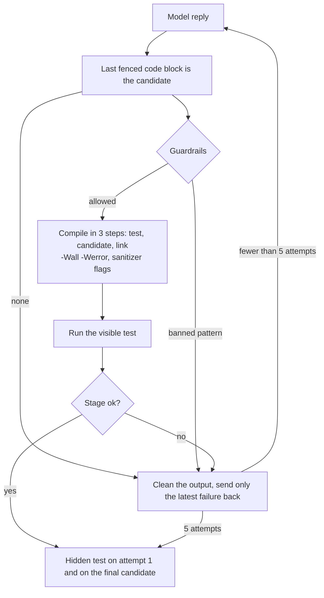

# bitask: verifying LLM-written C/C++ fixes

Language models write C and C++ fixes that look right. This project checks each fix with the real toolchain (`clang -Werror`, ASan, UBSan, TSan and the case's own tests) and with held-out tests before accepting it, and it feeds the failures back to the model.

## What I found

**1. A fix can pass the visible test and still add undefined behaviour.** For `midpoint` (case 02), gpt-oss-20b removed the original overflow but added a new one at `INT_MIN`. Its final return line:

```c
return - (int)(((-sum) + 1) / 2);
```

The visible test passed clean under the sanitizers. Only the hidden test caught it, with this cleaned UBSan output:

```
buggy.c:22:16: runtime error: negation of -2147483648 cannot be represented in type 'int'; cast to an unsigned type to negate this value to itself
SUMMARY: UndefinedBehaviorSanitizer: undefined-behavior buggy.c:22:16
```

**2. Default ASan accepts a plausible wrong fix.** Case 01's naive fix, `malloc(total + 1)`, passes ASan alone: `malloc(0)` returns a one-byte block, so the terminator write is in bounds. `-fsanitize=unsigned-integer-overflow` reports the wrap, so the harness enables it. See [finding 1](docs/findings.md#1-asan-accepts-the-naive-malloc0-fix--fsanitizeunsigned-integer-overflow-catches-it).

**3. UBSan can hide ASan's heap report.** With both sanitizers on, UBSan's object-size check reports a heap overflow as a weaker "insufficient space" message in place of ASan's `heap-buffer-overflow`. The harness adds `-fno-sanitize=object-size`. See [finding 2](docs/findings.md#2-ubsans-object-size-check-pre-empts-asans-heap-buffer-overflow).

**4. At `-O1` the compiler deletes buggy code whose result never escapes.** The unused allocation and the out-of-bounds store are removed before ASan sees them, so the binary exits 0 with nothing to report. Tests must make the effect observable across the function boundary. See [finding 3](docs/findings.md#3--o1-deletes-buggy-code-whose-result-never-escapes). On Docker Desktop, TSan also fails unless `vm.mmap_rnd_bits` is 28 or lower; see [finding 4](docs/findings.md#4-tsan-fails-at-mmap_rnd_bits32-with-check-failed-not-unexpected-memory-mapping).

The full evidence for each finding is in [docs/findings.md](docs/findings.md).

## How it works



Attempt 1 gets the buggy file and the visible test. Each retry gets the task, the previous attempt and the cleaned failure, and nothing older. The hidden test is never sent to the model. It runs after the loop, on attempt 1's candidate and on the final one, and the two verdicts are recorded separately.

| Stage | Meaning |
| --- | --- |
| `ok` | Compiled, and every run passed |
| `compile_error` | The candidate failed to compile or link |
| `sanitizer` | A sanitizer report, from any run |
| `test_fail` | A check failed, the exit code was nonzero, or the completion marker was missing |
| `crash` | Killed by a signal that no sanitizer caught |
| `timeout` | Exceeded the time limit |
| `harness_error` | An environment problem, not the candidate's fault |
| `rejected` | A banned pattern was found, so the candidate was not compiled |
| `no_code` | The reply had no fenced code block |
| `llm_error` | A provider error other than a rate limit. The run ends and the bench continues |

## Results

Two models, ten cases, two trials each. Pass counts over the 20 runs per model:

| model | one-shot visible / hidden | loop visible / hidden |
| --- | --- | --- |
| `openai/gpt-oss-20b` | 20/20 / 19/20 | 20/20 / 19/20 |
| `openai/gpt-oss-120b` | 20/20 / 20/20 | 20/20 / 20/20 |

- Both models passed every visible test on the first attempt, in all 40 runs. The retry path was never exercised, so these numbers do not show what the loop adds.
- The one hidden failure is the case-02 finding above: gpt-oss-20b, trial 2. Its other trial on the same case passed both tests.
- These are small samples. Two trials per model and ten small, well-known bugs that are likely in model training data. Treat the rates as indicative only. Per-case rows are in [out/results/results.md](out/results/results.md).

## Benchmark cases

| case | bug | sanitizers | what the hidden test checks |
| --- | --- | --- | --- |
| 01_heap_overflow | `join_words` allocates no room for the NUL | ASan, UBSan | Edge cases. The naive fix passes ASan alone and fails once the unsigned-overflow check is on |
| 02_signed_overflow | `midpoint` overflows in `int`, and truncates instead of flooring | ASan, UBSan | `INT_MIN` and `INT_MAX` extremes and the floor cases. The naive `a + (b - a) / 2` fails here |
| 03_iterator_invalidation | `push_back` reallocates the vector, so the loop's iterator points at freed memory | ASan, UBSan | Empty input, no evens, spare capacity, mixed signs. The naive fix fails even the visible test, with a UBSan overflow |
| 04_data_race | worker threads increment a shared counter without synchronisation | TSan | Several calls in one process. A naive atomic counter that never resets gives 41000 instead of 40000 |
| 05_use_after_free | `format_pair` frees its buffer, then returns it | ASan, UBSan | Two results alive at once, and a negative value |
| 06_double_free | `upper_copy` frees its result on empty input | ASan, UBSan | The empty string first, then mixed case |
| 07_off_by_one | `sum_values` uses `i <= n`, reading one int past the end | ASan, UBSan | An empty array (a one-byte block) and a single element |
| 08_memory_leak | `word_count` never frees its copy of the input | ASan (LeakSanitizer) | Leading and repeated spaces. The leak itself is reported on every run |
| 09_null_deref | `label_length` passes a NULL to `strlen` | ASan, UBSan | A negative level, and the middle label |
| 10_uninitialised_read | `sum_upto` never initialises its accumulator | ASan, UBSan | The empty range and a longer range. `-Werror` rejects the buggy file first (`-Wuninitialized`) |

Cases 01–04 each have a naive fix recorded in `tests/fixtures/naive_fixes/`, which the tests check. Cases 05–10 have a reference fix only.

## Try it

You need Docker. The image is built on Ubuntu 24.04 with clang 18; see [docs/harness.md](docs/harness.md#environment).

```bash
docker build -t verify-harness .
docker run --rm --cap-add SYS_PTRACE --network none -v "$PWD":/work:ro verify-harness \
    python3 -m verifyloop.cli verify --case bench/cases/01_heap_overflow
```

The first command fails on purpose: the buggy file reports a heap-buffer-overflow under ASan. The second command runs a model on a case, and it needs a key in `.env` (`GROQ_API_KEY=...`, or `LLM_API_KEY`). See [.env.example](.env.example).

```bash
mkdir -p out
docker run --rm --env-file .env -v "$PWD":/work:ro -v "$PWD/out":/work/out verify-harness \
    python3 -m verifyloop.cli fix --case bench/cases/02_signed_overflow --model openai/gpt-oss-20b
```

Everything else, including the CLI flags, the `bench` command and troubleshooting, is in [docs/harness.md](docs/harness.md).

## Design choices

- **Held-out tests.** The hidden test is never sent to the model, and it runs only after the loop, so a fix cannot be tuned to it.
- **A known-wrong fix for the first four cases.** Each records a naive fix, and the tests check that the hidden test rejects it, so the hidden test is shown to catch a real mistake.
- **Per-case sanitizers.** Each case lists its sanitizers. The TSan case runs TSan alone, because ASan and TSan cannot run in one binary.
- **Deterministic, cleaned errors.** The model gets sanitizer output with addresses and PIDs masked and libc frames dropped, so the same bug always produces the same text.
- **Tests run offline.** The test container has `--network none`, because compiled code is untrusted. Model-written code runs only in the fix and bench container, which has network access.
- **Cached, resumable runs.** Replies are cached by request, so a repeated command makes no new call, and a stopped bench picks up where it left off.

## Limitations and next steps

- Single-file cases only. Linux and Docker only. No MemorySanitizer and no Valgrind.
- The fix and bench commands run model-written code with network access. The guardrails are not a sandbox.
- The completion marker is not secure against deliberate cheating: `VERIFY_NONCE` is visible to candidate code.
- The benchmark has ten starter cases and two trials per model. It is not a real-world corpus.
- On Docker Desktop, TSan needs the ASLR fix again after each restart. See [docs/harness.md](docs/harness.md#9-troubleshooting).

The next kind is a `project` case, with multi-file code and build systems, for real-world bugs. Candidates are ARVO, Defects4C, BugsCpp and VulnLoc/ExtractFix, listed in the [C-CppBench catalogue](https://github.com/ByteAsk/C-CppBench). The design is in [docs/spec.md](docs/spec.md#future-real-world-track-not-layer-1).

## Repository layout

```
bitask/
  Dockerfile                 pinned base image, clang-18, sanitizer runtimes
  .env.example               template for the LLM settings (copy to .env)
  docs/
    spec.md                  the design and the decisions, by phase
    harness.md               reference: environment, CLI, pipeline, stages, fix and bench, troubleshooting
    findings.md              toolchain findings, with evidence
  verifyloop/
    case.py                  case loading and validation
    toolchain.py             verify(), the stage classifier, output cleaning
    llm.py                   complete(): cache, rate-limit retries, providers
    loop.py                  fix(): attempts, guardrails, retries, hidden test, logs
    bench.py                 run_bench(): one-shot against the loop, pass rates
    cli.py                   verify, fix and bench subcommands
  bench/
    common/check.h           CHECK macros and the completion marker
    cases/NN_name/           the ten starter cases
  tests/                     unit and starter-case tests, run in the container
  smoke/                     sanitizer smoke programs
  out/results/               committed benchmark results
  scripts/fix-aslr.{sh,ps1}  lowers vm.mmap_rnd_bits in the Docker Desktop VM
```

- [docs/spec.md](docs/spec.md): the design and the decisions made in each phase.
- [docs/harness.md](docs/harness.md): the full reference.
- [docs/findings.md](docs/findings.md): eight toolchain findings, with evidence.
- `bench/cases/*/NOTES.md`: each case's bug, sanitizer output, fixes and stage table. For example, [01_heap_overflow](bench/cases/01_heap_overflow/NOTES.md).
